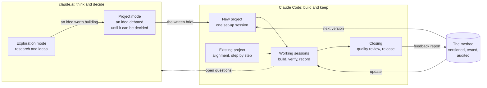

# Architecture

The Streanga Method covers the whole life of a project built with Claude: the first idea, the
decision to build it, the build, every working session after that, the release, and the lessons
that flow back into the method. It runs on both surfaces where that work happens, **claude.ai**
and **Claude Code**, and it has a path for both kinds of project: **a new one**, started on the
method from its first commit, and **an existing one**, brought onto it without losing anything it
already has.

This page shows how the parts fit together. The reasons behind them are in
[Principles](PRINCIPLES.md); what they achieved is in the [case study](CASE_STUDY.md).

## The whole method on one page

Four things to notice:

- **Two surfaces, one method.** Thinking happens where iteration is cheap and nothing is
  touched; building happens where the agent can read, run and measure. Each surface has its own
  architecture, below, and they meet at a single, written hand-off.
- **Two ways in.** A new project and an existing one end up in the same working cycle, with the
  same rules, tools and checks. They only differ in how they get there.
- **One way back.** Every project reports what it learned, and the method changes on that
  evidence. A good solution found in one project reaches all of them.
- **The method is itself a project, the sixth.** It has its own repository, tests, versions and
  audits, it was aligned by its own procedure, and it improves itself through the same loop it
  runs for the other five.

---

## 1. The chat side (claude.ai)

The chat side is a complete project prompt for claude.ai. It turns Claude into a thinking
partner that challenges the author, separates what is known from what is assumed, and ends every
conversation with a document that someone who never saw the chat can read and act on.

### Two modes

| | Exploration mode | Project mode |
|---|---|---|
| **Purpose** | Research and new ideas, with nothing to build yet | Take one idea far enough that the author can decide whether to build it |
| **How it works** | A short search plan the author can cut or extend; primary sources before secondary ones; the author's own ideas first, so Claude's do not anchor them; then a wide set of ideas, some under forced constraints ("no money", "local only", "ready in a day") | It starts from the problem and what already exists; two or three approaches are weighed, with the strongest form of each rejected one stated before it goes; the work is split into areas that code can verify and areas only the author can judge, with worked examples for the first, the author's own or candidates drawn by Claude Code, each with the author's verdict; a smallest first version; only then, once it is clear what the project does, the author's own description of it and its name; a pre-mortem and the single assumption that would make the project pointless if false |
| **Every finding gets** | A verdict: worth following, eliminated with the reason, or unverified with how to verify it | A place in the brief: decided, out of scope, a sign to watch, or open |
| **It ends with** | An exploration file, checked against a six-point gate before delivery | An ideas brief, checked against a five-point gate, then tested in a fresh chat that sees only the document |

### What holds every conversation together

- **A mode and a stopping condition, agreed at the start.** A conversation without a written
  "done" never closes.
- **One question per message.** A choice is asked in plain text: first the criteria for choosing,
  then the options, numbered, the recommended one first with its reason; the author answers with
  a number or in their own words. The author works by voice dictation, so the prompt reads past dictation errors and asks only
  when two readings differ on a fact such as a name or a number.
- **Disagreement on purpose.** Claude contradicts when it has a reason, at the start of its
  answer, with the reason.
- **Decisions stay honest.** When a new fact touches an earlier decision, the decision is reopened
  at once, without being asked. Anything rejected stays rejected unless a new fact brings it back.
- **Facts are searched or marked.** Figures, versions and the existence of a project come from a
  search; otherwise they are labelled unverified.
- **Money and personal data are flagged the moment they appear**, because either can stop an idea.
- **The author confirms the end.** When Claude thinks the work is done, it proposes closing in a
  question of its own, with what was postponed or left open. Only after a yes is the document
  checked and written, once.
- **The gate is checked on the text.** Before delivery, the document is checked against the gate
  point by point, and each result is reported in the chat in the gate's own wording; a point that
  fails is reported as failing, not rephrased until it passes.
- **Two failed corrections on the same point change the approach**, and a long conversation is
  carried into a fresh one by a written summary rather than allowed to drift.

### Built and tested like the code side

The chat prompt is kept in the method's repository, not in the chat, and versioned with it. It
was given to a model that had never seen the conversation that produced it and reviewed over
five rounds, which surfaced pairs of rules that asked for different things in the same situation.
Each conflict was resolved, and the review was closed by a written decision once the remaining
points were effects of earlier fixes.

---

## 2. The bridge: from the chat to the build

Only the written brief crosses from claude.ai into Claude Code. It enters the new project as its
founding text and is never edited afterwards, so the intention the project started from can
always be compared with what it became.

- **Nothing is asked twice.** The set-up interview in Claude Code reads the brief first and asks
  only the questions it leaves open.
- **What the chat decided is checked later.** The worked examples from the chat must each end up
  as a test, and the quality review counts the ones that did not. The assumption that would make
  the project pointless gets a verdict at closing: confirmed, disproved or still unverified.
- **Each surface keeps its own decisions.** The chat decides what is worth building and why. How
  it is specified, verified and structured is decided in Claude Code, where the code is.

The bridge also runs the other way while a project is being built. Open, theoretical questions
that need many rounds of discussion go back to the chat; execution, measurement and anything
written to disk stay in Claude Code.

---

## 3. The build side (Claude Code)

### Path A: a new project

Since October 2026 this is the method's main path. A new project gets, on its first day, what the
existing projects only gained through alignment.

1. **One set-up session, and nothing else in it.** No product code is written. The session reads
   the method once and builds the project's working environment.
2. **A six-question interview**, one question at a time: what the project is and does; whether it
   calls a paid model; which areas code will verify and which the author will judge; what gets
   installed on the machine; whether personal data is involved; what it reuses from earlier
   projects. The answers decide which optional parts of the method apply, and the reasons are
   written down the same day.
3. **The environment, copied, not composed.** The general parts are copied word for word from the
   method, so that every project carries the same mechanism and none drifts into its own variant.
   They include the agent's instructions under a fixed size budget, the permissions, the checks
   that stop a bad commit, the measuring tools, the commands for repeatable work, and the files
   that carry the project's state and specification from one session to the next.
4. **Proof that it works.** A deliberately broken file must be blocked by the project's checks
   before the session can finish, and the start-up cost is measured and recorded.
5. **One commit, then stop.** Work starts in a new session, on a clean environment.

Some parts appear only when the project produces something for them, such as a test suite, a log
of lessons or an installation guide. An empty file that looks like content is worse than no file.

The whole path has been run end to end in automated trials: from the interview to a ready project
of 29 files in a single commit, with every rule checker clean, in about forty requests.

### Path B: an existing project

A project that was not born on the method is aligned in a fixed sequence of sessions, with one
kind of change per session, so that any regression has a single cause:

1. **Audit and comparison:** what the project has, set against what the method asks for.
2. **The working environment:** instructions, permissions and checks brought into line.
3. **A test safety net,** written from the project's own existing criteria, so that everything
   the project already verified is checked automatically before anything else changes.
4. **The tools:** measuring and session tools updated.
5. **The content:** decisions, lessons and documentation brought into the method's form, then
   verified as a whole.
6. **Publication:** a private backup of the full history, and, where the project is shown
   publicly, a separate public repository derived from it.
7. **The return:** a feedback report to the method.

Nothing the project already has is overwritten: what it invented is kept, and what is better
than the method's version is reported back.

### Path C: keeping up with the method

When the method changes, each project is brought to the new version by one standing procedure
that works out what is new from the method's own version history, so the procedure itself never
goes out of date. A tool compares every copied file in a project with the method and reports
each one as current, behind, locally changed or missing.

### The working cycle

Both paths lead into the same cycle:

- **Every session starts from disk.** The agent remembers nothing between sessions, so the state
  of the work, the open debts and the next step are written down and committed before a session
  ends. A new session opens from a prompt prepared by the previous one.
- **Repeatable work has its own commands:** a factual audit, a repair pass on what the audit
  found, an idea pass, a technical specification, a session hand-over, opening the next session,
  and a quality review.
- **Rules are held by mechanisms.** Permissions the agent does not have, checks that stop a
  commit, hooks inside the agent's own loop, tests that fail. Every commit records how full the
  session's context is, and says so when the session should end.
- **Verification is chosen per area.** The method keeps a catalogue of twenty verification
  patterns and five architecture patterns, each taken from a project where it worked:
  independent recalculation of every figure, a three-state verdict (correct, wrong, unverified),
  numbered guards that stop a run, a versioned corpus with an automatic verdict, test files broken
  on purpose, and others.
- **Measurement before decision.** The start-up cost, the cost of whole sessions and the cost of
  paid API calls are each measured by a tool, from the session's own records.

### The quality review

The factual audit says whether the project follows its own rules. The quality review asks
whether the work is good, and reads the code against six references:

1. what the project declared about itself;
2. mechanical tools (linters and similar);
3. the original intention;
4. the verification patterns that fit each area of the project;
5. the change history, including which files always change together;
6. behaviour at the edges: what happens when a write is interrupted, a file is malformed or a
   request comes from somewhere unexpected. This reference was added from the defects one
   project's review found, and four days later it found the same kinds of defect in another.

A rule the code breaks leads to one of two outcomes, and the review writes down both: fix the
code, or retire the rule. A rule left written and broken is not an option. The review is part of
every closing, every project has a recorded quality baseline, and the next review is compared
with it. On JA.S.Mine and SkyRoll it found defects that every other check had passed; they were
fixed the same day (see the [case study](CASE_STUDY.md#the-quality-review)).

### Closing a project

Closing is a written sequence of nine steps in a fixed order, so that a finished version is a
recorded fact rather than a feeling: a factual audit; repairs in a fresh session, so the instance
that repairs is not the one that audited; a second audit, then the quality review; the installation guide written and then followed on the machine; an idea pass; the
technical specification; the author's reading in a fresh session; the version declared and
committed; and the report back to the method.

---

## 4. The ready-made toolkit

A new project does not start from a blank page. Everything below exists once, in the method.
At set-up the tools and checks are copied into the project unchanged, and they are covered by the
method's own tests; the templates are filled in for the project; the catalogue is consulted for
each area of the work. Each piece was built because a real project needed it, and the reason is
recorded with it.

**Measuring cost**
- start-up cost: what the project's own files add to every request of a session;
- the real request: the full first request sent to the model, weighed through the API, including
  the system prompt and tool definitions that the project does not write;
- the context in use right now, read from the session's own records;
- whole sessions: how much each session processed, how far its context grew, and how much an
  average commit adds, from the transcripts and the version history;
- paid API calls: what each program has spent this month, so a budget shared between projects
  shows which one overran it.

**Enforcing rules**
- a syntax check that runs after every edit of a Python file and stops a broken file at once;
- a check on every answer of the agent: none may end without saying where the work stands and
  what comes next;
- a gate before every commit: the state of the work and the record of decisions keep their
  form, and copies of the method's tools are unchanged;
- the context figure written into every commit message, with a warning past the session ceiling;
- an automatic push to the private backup after every commit;
- secret scanning before anything is published, and an installer that puts the commit checks in
  place on a new machine;
- a rule checker that runs every rule of the method that can be checked by search.

**Continuity between sessions**
- a check on the form of the state of the work, before every commit;
- a new-session flow: the closing session writes the next prompt, opens the new session in the
  editor and closes the old one, through a small helper and an editor extension.

**Commands for repeatable work**
- seven commands: factual audit, repair, ideas, technical specification, session hand-over, new
  session, and quality review.

**Documentation**
- a guide for writing a project's technical specification, and a checker that verifies it
  against the code;
- a check after moving a project to a new folder, listing everything that still points to the old
  one;
- feedback prompts that turn a project's experience, in code or in chat, into a report for the
  method.

**Templates**
- every file a project starts with: the agent's working instructions, the state of the work, the
  specification, ignore rules and line endings, permissions, the way of working with the author,
  the project's principles, a log of lessons, closed decisions, the installation guide and the
  public description.

**A catalogue of patterns**
- twenty verification patterns: independent recalculation; a three-state verdict; a warning
  raised only when the phenomenon occurs; counterfactual reconciliation; a catalogue of elements
  with markers; a completeness guard; identification by content, not by name; numbered guards
  that stop a run; an isolated configuration suite; a versioned corpus with an automatic verdict;
  old against new on the whole archive; a recorded corpus run through the product's own chain;
  measurement as a set of commands; figures kept apart from reasons; a live probe that asks each
  service whether it is alive; a health check that never touches the paid API; a start-up that fails loudly; test files broken on
  purpose; an acceptance test in steps that locates the failing one; a backup before any
  destructive operation;
- five architecture patterns: a table of where a model judges and where it does not; separation
  by reason for change; a single source for judgement; a graded verdict rather than a binary one;
  deterministic code for every figure.

**Tools that run across all projects**
- the cost of reading the method itself, so the set-up figure is measured, not estimated;
- the state of every project's copies against the method: current, behind, changed locally or
  missing;
- the quality of every project, gathered from its quality reviews and history;
- a guard that checks this public showcase gives the method's architecture without its content.

---

## 5. The sixth project: a method that improves itself

The method is run as a project, under its own rules, and its history is the clearest evidence of
how it works: it gets better from what the projects report, and from auditing itself.

| | When | What changed |
|---|---|---|
| **Version 1** | 29 September 2026 | The first audited version: a single document of 5,793 lines, with every tool written into it as text. |
| **Versions 1.1 to 1.8** | 30 September to 6 October | Eight versions, each driven by feedback reports from the projects being aligned. The tools became real files that projects copy; the commands became files too; the session ceiling came from two projects whose sessions had passed half a million tokens; the new-session flow came from SkyRoll. |
| **Its own alignment** | 7 October | The method's repository was aligned by its own procedure, like any existing project. Its start-up cost fell from about 41,000 tokens to 12,200–14,800, and its tools gained an automated suite that runs before every commit. |
| **Version 2.0** | 8 October | A two-day audit of the whole method produced 68 findings, and every one that called for a change was applied. The chat side, the bridge to code and the quality review became part of the method. |
| **Version 2.1** | 10 October | The chat side after its first real use, one conversation in each mode, analysed from the exported transcripts: the author confirms the end, the gate is checked on the text, choices are asked in plain text, and project mode starts from the problem. Public texts that promise something about a repository are now checked against what was published. |

**The loop that drives it.** A project reports what it learned. A proposal enters the method only
together with what will enforce it: a test, a tool, a step in a command, a permission; until then
it waits on a list of candidates. The projects are then updated to the new version, use it, and
report again. Twenty-two written reports have gone round this loop so far.

**It grows by getting smaller.** Between version 1 and version 2.0 the operating manual went from
5,793 lines to about 4,500 while gaining a second surface, a quality review and a tested toolkit. Code
moved out of the text into tested files, duplicates were removed, and retiring a rule is a
defined step, with its reasons kept. Reading the method for a new project's set-up fell from 133,000 tokens,
measured on version 1, to 87,000.

**It audits itself the way it audits projects.** The audit before version 2.0 asked four
questions: can the method measure its own results, does it still cover what it set out to cover,
what has changed in Claude Code since the last version, and how does an idea travel from the chat
to the code. The 68 findings split into 53 on the method, four on the hand-off from chat to code,
seven on changes in Claude Code, and four from Claude Code's own prompt review. Among the results:
the method can now measure whether products get better, nothing settled in the chat is lost on
the way to the code, and confidential material is protected by a permission, not by an
instruction. The same audit noticed that the method had released versions as often as the
projects once did, a habit it had corrected in them; version changes are now decided by the
author, and a major version comes only after an audit.

---

## Who does what

| | Role |
|---|---|
| **The author** | The domain expert and architect. States what the project is, judges every result in the areas only a person can judge, and settles the open questions. |
| **Claude in claude.ai** | Thinking partner: researches, challenges, keeps the decisions honest, writes the brief. |
| **Claude in Claude Code** | Builder: writes the code, runs it, measures it, records the state of the work. |
| **Deterministic code** | Computes every figure and performs every irreversible action. |
| **A second instance** | Reviews work that matters, seeing only the result, never the conversation that produced it. |

---

© 2026 Mihai Streanga. All rights reserved.
